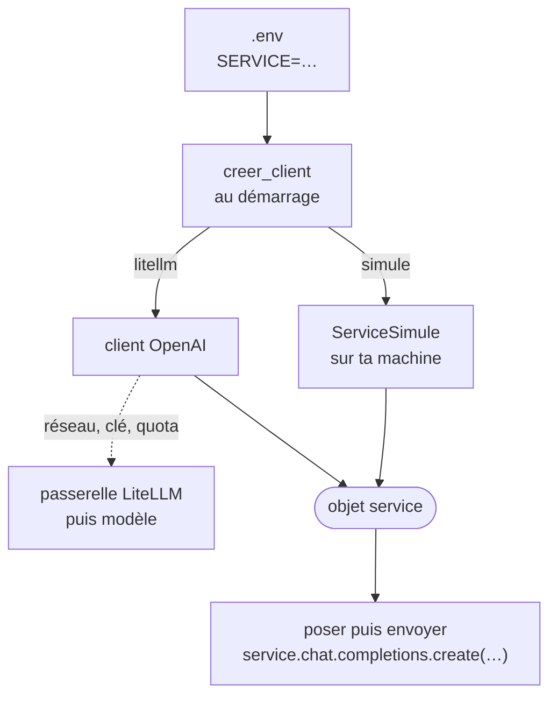
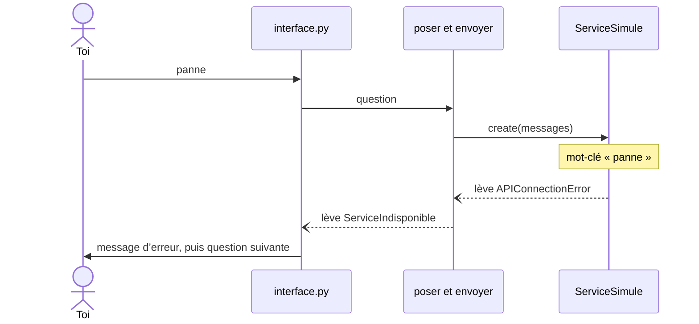
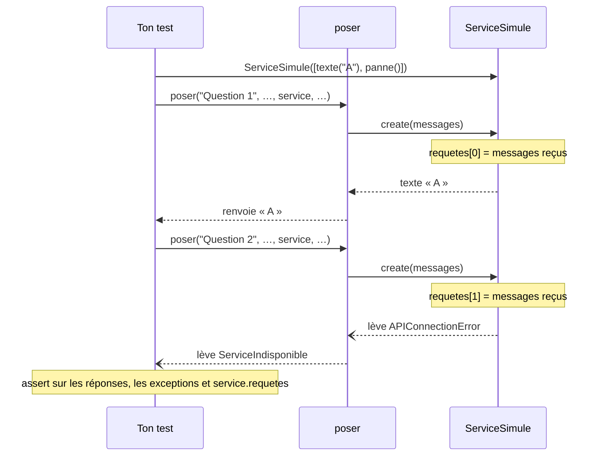

# Le service simulé

Le service simulé remplace le service d’IA par un faux service écrit en Python, qui tourne sur ta machine. Il sert à essayer ton assistant et à le tester sans réseau, sans clé et sans consommer ton quota.

## Pourquoi un faux service

|  | Vrai service (passerelle LiteLLM) | Service simulé |
| --- | --- | --- |
| Réseau et clé | nécessaires | inutiles |
| Quota | consommé à chaque question | jamais consommé |
| Réponses | différentes d’un essai à l’autre | toujours les mêmes |
| Panne, délai dépassé, clé refusée | impossibles à provoquer à volonté | sur demande |
| Appel d’outil, arguments mal formés | quand le modèle le décide | sur demande |

Pour vérifier que ton programme réagit bien à une panne ou à un appel d’outil, il faut pouvoir la provoquer, à chaque essai, de la même façon. Le vrai service ne le permet pas.

## Ton code ne change pas

`ServiceSimule` s’utilise exactement comme le client OpenAI : `service.chat.completions.create(model=…, messages=…)`. Il renvoie les mêmes réponses et lève les mêmes exceptions que le SDK.

Le choix se fait une seule fois, au démarrage, dans `creer_client` (`assistant/client.py`), d’après la variable `SERVICE` de `.env`. Ensuite, `poser` et `envoyer` reçoivent un objet `service` sans savoir lequel des deux c’est.



## Deux façons de l’utiliser

### Essayer à la main : `SERVICE=simule`

Mets `SERVICE=simule` dans `.env`, puis lance l’assistant. Le service simulé cherche un mot-clé dans la première ligne de ta question pour choisir sa réponse : `panne`, `lent`, `refus`, `lis <fiche.md>`, `écris <fiche.md>`, `boucle`, `invalide`, `inconnu`. Sans mot-clé, il renvoie un texte. La liste complète est en tête de [`assistant/service_simule.py`](../assistant/service_simule.py).



Tu vérifies ce que **tu vois** : le message affiché, l’assistant qui continue.

### Vérifier automatiquement : `ServiceSimule([…])` dans un test

Dans un test, tu crées toi-même le service avec la liste des réponses qu’il doit renvoyer, dans l’ordre. `SERVICE` et `.env` ne jouent aucun rôle : le test passe le service directement à `poser`. Après l’appel, `service.requetes` garde ce que le service a reçu.



```python
from assistant.service_simule import ServiceSimule, panne, texte

service = ServiceSimule([texte("A"), panne()])
```

Ton test vérifie ce que **ton code fait** : ce qu’il renvoie, ce qu’il lève, ce qu’il a envoyé au service.

## À retenir

- Un test n’appelle jamais le vrai service : il doit réussir sans réseau, sans clé et sans `.env`.
- `SERVICE=simule` sert à essayer à la main, `ServiceSimule([…])` sert dans les tests.
- Avant la démonstration, remets `SERVICE=litellm` dans `.env`.
